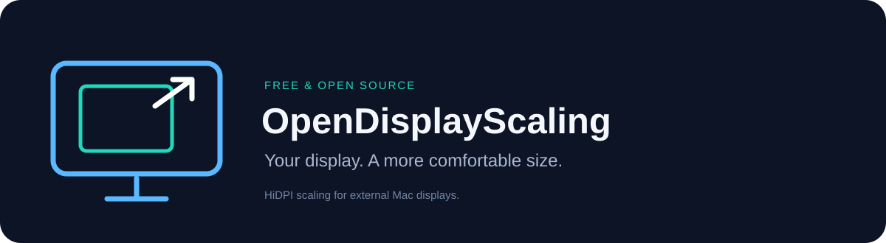
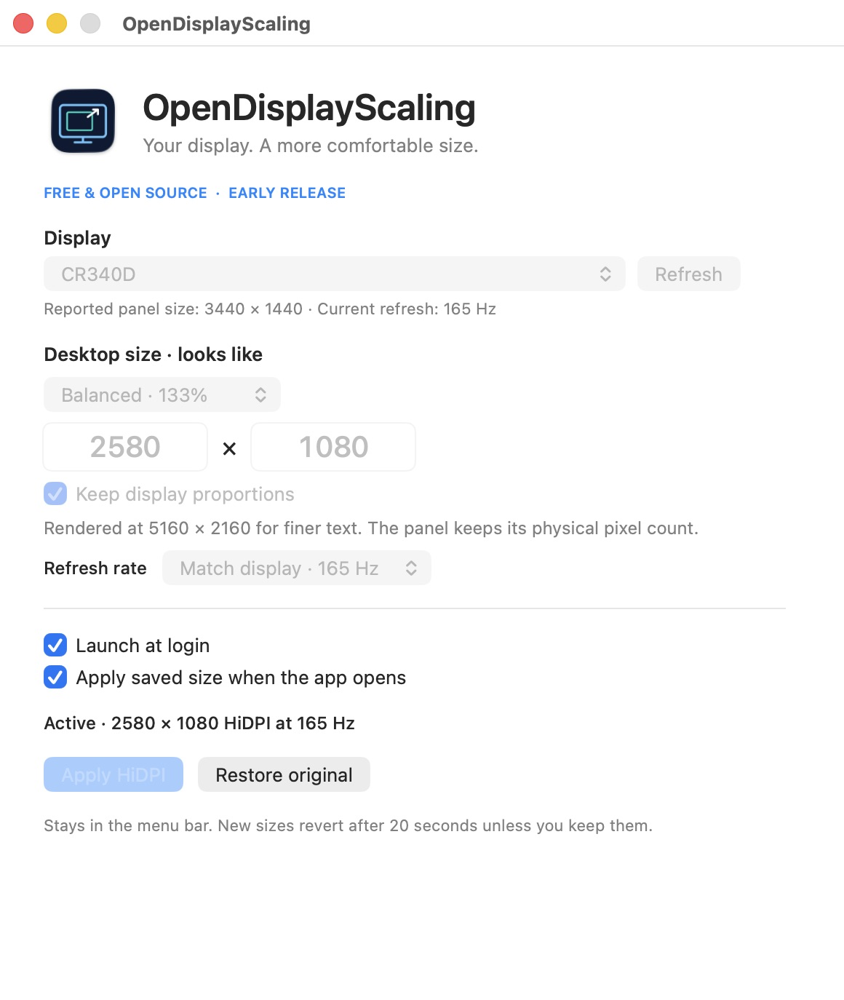

<p align="center"></p>

<p align="center">
  <a href="LICENSE"></a>
  
  
  <a href="https://github.com/colmecti/OpenDisplayScaling/releases/tag/v0.1.0"></a>
</p>

**A free, open-source Mac display manager with custom HiDPI scaling.**

The `main` branch contains the **0.2 development preview**: a native sidebar,
per-display controls, virtual screens, saved groups, hardware controls and local
picture-in-picture. See the [feature coverage](docs/FEATURES.md) for implemented
controls, system-settings shortcuts and remaining gaps. The published **v0.1.0**
download remains the earlier scaling utility while v0.2 hardware and final UI
validation are pending.

Choose a monitor, enter the desktop size you want, and apply it. OpenDisplayScaling
renders the desktop at twice that width and height, then mirrors it to your monitor.
This can make text look better than an ordinary low-resolution mode while keeping
the interface comfortably sized.

**[Download the Mac app](https://github.com/colmecti/OpenDisplayScaling/releases/tag/v0.1.0)** ·
[Build from source](#build-from-source) · [Report a problem](https://github.com/colmecti/OpenDisplayScaling/issues/new/choose)

> **Early release.** Uses private macOS APIs and has been tested on one Apple M5
> setup running macOS 26.3.1. The downloadable app is ad-hoc signed, **not
> Developer ID signed or Apple-notarized**. Read [installation](#installation)
> and [known limits](#known-limits) before using it.

<p align="center"></p>

## What it does

The following describes the v0.1 scaling engine, retained in v0.2. For the expanded
display manager, see the [full feature table](docs/FEATURES.md).

- **Custom desktop size.** Enter width and height, or start with a size preset.
- **Display proportions.** Keep the monitor's proportions while editing either dimension.
- **HiDPI verification.** Checks the actual logical size, 2× rendering size, and rendering refresh rate before calling a change active.
- **A way back.** New manual changes have a 20-second confirmation countdown. Unconfirmed changes request the previous setup.
- **Menu-bar controls.** Restore the original setup without quitting, or quit to stop scaling.
- **Launch at login.** A checkbox uses macOS's login-item system. A separate checkbox reapplies your last confirmed size when the app opens.
- **Local settings.** No accounts, subscriptions, analytics, in-app network requests, or automatic updates.

One external display can be scaled at a time. Other monitors keep their resolution.
The app must remain running to maintain its virtual display.

## Installation

1. Download `OpenDisplayScaling-0.1.0-arm64.zip` and `SHA256SUMS.txt` from the
   [release](https://github.com/colmecti/OpenDisplayScaling/releases/tag/v0.1.0).
2. Optionally verify the archive in Terminal: `shasum -a 256 -c SHA256SUMS.txt`.
3. Unzip it and move **OpenDisplayScaling.app** into **Applications**.
4. Open the app. Because this preview is not notarized, macOS may block it.
   If you choose to trust this release, follow Apple's
   [official instructions for opening an unverified app](https://support.apple.com/102445).
   Do not disable Gatekeeper or System Integrity Protection.

The published v0.1 app does not need administrator, Accessibility, or Screen
Recording access. In the v0.2 source preview, local picture-in-picture requests
Screen Recording only when you open it. Other display controls do not require
that permission. The bundled DDC helper is unprivileged; global shortcuts use
Carbon registration without monitoring arbitrary keyboard input.
If you prefer not to run a downloaded unnotarized binary, build the source locally.

## Choose a comfortable size

1. Select your physical external display. Stop other mirroring/scaling apps first.
2. Enter the **looks-like desktop size**, not your panel's resolution. Smaller
   numbers make text and controls larger. For example, a 3440 × 1440 ultrawide
   can use a 2580 × 1080 desktop, rendered at 5160 × 2160.
3. Leave **Keep display proportions** checked unless you intentionally want a
   different aspect ratio. Different proportions may produce black bars.
4. Choose a rendering refresh rate. The default matches the current display rate;
   try 60 Hz if your requested combination fails.
5. Click **Apply HiDPI**, then **Keep this size** if the result looks right.

Use **Restore original** before choosing another monitor or size. Closing the
settings window leaves the app in the menu bar. Quitting removes the temporary
virtual display and requests your original display mode and layout.

### Launch at login

With the app in Applications, check **Launch at login**. If macOS requires approval,
the app shows a button to open Login Items settings. The checkbox reflects the
system's registration status, including pending approval.

To resume scaling too, check **Apply saved size when the app opens** after keeping
a working size. It waits for that same monitor to be connected, then attempts the
saved configuration once per app launch. Both options are off for new users.

After an unexpected exit, automatic reapply is suppressed for the next launch
and recovery of the recorded setup is attempted. Apply manually after checking
your displays. After a normal disconnect, reconnect and apply again.

## How it works

```text
Your chosen desktop       2× HiDPI rendering        Physical monitor
2580 × 1080          →      5160 × 2160         →      3440 × 1440
comfortable UI              finer detail               same panel
```

The app creates a temporary `CGVirtualDisplay` and uses macOS display mirroring
to present that desktop on the selected monitor. It does not rewrite EDID,
install a privileged helper, change SIP, or patch the operating system.

This improves the rendering path; it does **not** add physical pixels to a monitor
or guarantee Retina-like sharpness. System Information may report the rendered
resolution for a mirror set. That is not a claim that the physical panel changed.

## Known limits

- **Apple silicon, macOS 13+.** macOS 26.3.1 on Apple M5 is the only hardware/OS
  combination tested so far. Earlier supported deployment targets are unverified.
- **Private APIs.** A macOS update may break virtual-display behavior.
- **Custom virtual scaling: one external display at a time.** Built-in displays and already mirrored
  or rotated displays are not supported targets. DisplayLink and other virtual-display
  software have not been validated.
- **SDR desktop use first.** HDR, VRR/ProMotion behavior, protected video,
  fullscreen games, color-critical work, and capture software are not validated.
- **Conservative size limits.** Even dimensions, width 640–3072, height 480–3072,
  and a maximum 24-million-pixel 2× framebuffer. Hardware can impose tighter limits.
- **Performance varies.** Higher render sizes and refresh rates use more GPU
  resources. A reported 165 Hz mode is not a measured latency or frame-pacing result.
- **Recovery is best effort.** macOS can change available modes or display IDs
  after reconnection. See [troubleshooting](docs/TROUBLESHOOTING.md).
- **Validation is still limited.** See the explicit passed and pending checks in
  [TESTING.md](docs/TESTING.md), including login and sleep/wake limitations.

## Build from source

Install Xcode Command Line Tools (or Xcode) on a Mac, then:

```sh
git clone https://github.com/colmecti/OpenDisplayScaling.git
cd OpenDisplayScaling
make build
make test
open build/OpenDisplayScaling.app
```

Build output is an ad-hoc-signed Apple silicon app. No package manager or
separately installed third-party runtime dependency is needed. The build compiles
and bundles the MIT-licensed m1ddc helper from the pinned vendored source. For login-item testing, move the
app into Applications before opening it.

`make package` builds, runs the non-display tests, and creates an app ZIP plus
SHA-256 checksums in `dist/`. `make clean` removes only `build/` and `dist/`.
See [architecture](docs/ARCHITECTURE.md) and [release process](docs/RELEASING.md).
[GitHub Actions](https://github.com/colmecti/OpenDisplayScaling/actions) builds,
tests, and packages pushes to `main` and pull requests using the
[CI workflow](.github/workflows/ci.yml). The original v0.1.0 preview was built
and checked locally before hosted CI was added.

Read-only interface preview (does not register login items, recover sessions,
apply display settings, start capture, or probe hardware):

```sh
build/OpenDisplayScaling.app/Contents/MacOS/OpenDisplayScaling --preview
```

Read-only diagnostics:

```sh
/Applications/OpenDisplayScaling.app/Contents/MacOS/OpenDisplayScaling --version
/Applications/OpenDisplayScaling.app/Contents/MacOS/OpenDisplayScaling --diagnostics
```

Diagnostics omit display UUIDs and serial numbers. Review any information before
posting it publicly.

## Contributing and license

Bug reports with specific hardware and macOS versions are especially useful.
Read [CONTRIBUTING.md](CONTRIBUTING.md) and [SECURITY.md](SECURITY.md).

**MIT licensed.** You can use, modify, and redistribute it, including commercially,
under the terms in [LICENSE](LICENSE). Preserve the copyright and license notices.

Thanks to [Petr Baudis's hidpi-mirror](https://github.com/pasky/hidpi-mirror) for
the private API declarations and implementation findings that informed this app.
Full attribution and license text are in [ThirdPartyNotices.md](ThirdPartyNotices.md).

Maintained by [colmecti](https://github.com/colmecti). Not affiliated with Apple or
any monitor manufacturer.
